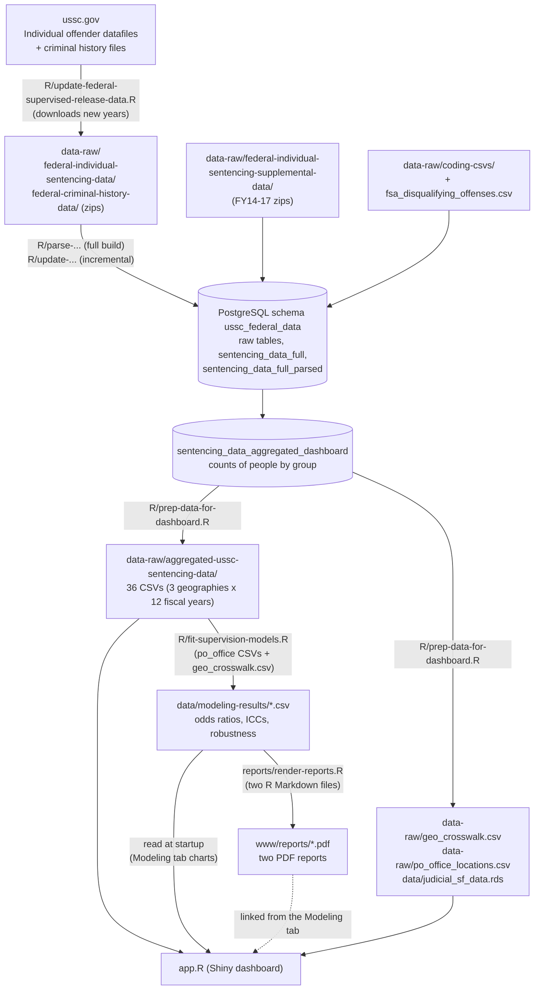

# USSC Federal Sentencing Dashboard

An R Shiny dashboard for exploring federal sentencing outcomes, with a focus on **supervised release** and **probation**, using the U.S. Sentencing Commission's (USSC) individual offender datafiles for fiscal years 2014 to 2025. Rates and counts can be viewed by state, judicial district and probation office, and sliced by age, race and ethnicity, education, gender, offense category, sentence type and citizenship.

This README documents the whole data pipeline: how the data is **collected**, **cleaned**, **loaded into a database**, **aggregated for the app**, and how the app is run and deployed. For a plain-language guide to the *dashboard itself* (ways to use it, key terms, a data dictionary, methods and caveats), see the **About** tab in the app. The **Overview** tab gives a general overview and national statistics, and the **Modeling** tab (page title *Modeling Supervision Rates*) summarizes the 2026 mixed-effects analysis of supervised release and probation rates, with charts and two PDF reports.

The two analysis reports are in this repo as polished PDFs ([supervised release](www/reports/supervised-release-report.pdf) and [probation](www/reports/probation-report.pdf)), and the Modeling tab links to them. Both are written as R Markdown files in `reports/`, and the R script that fits the mixed-effects models is `R/fit-supervision-models.R`. The original exploratory modeling code is in a separate [modeling code repository](https://github.com/REFORM-Alliance/Data-Science-Internship-2026-).

## Contents

- [How the pieces fit together](#how-the-pieces-fit-together)
- [Repository layout](#repository-layout)
- [Run the dashboard](#run-the-dashboard)
- [Setup for the data pipeline](#setup-for-the-data-pipeline)
- [Step 1: Collect the raw files](#step-1-collect-the-raw-files)
- [Step 2: Parse, clean and upload](#step-2-parse-clean-and-upload)
- [Step 3: Prepare the app data](#step-3-prepare-the-app-data)
- [Step 4: Deploy](#step-4-deploy)
- [Refreshing the data](#refreshing-the-data)
- [How the app uses the data](#how-the-app-uses-the-data)
- [The Overview, Modeling and About tabs](#the-overview-modeling-and-about-tabs)
- [Modeling results and the PDF reports](#modeling-results-and-the-pdf-reports)
- [Optional analysis script](#optional-analysis-script)
- [Known issues](#known-issues)

## How the pieces fit together



Everything is run from the project root (open `ussc-federal-supervised-release-dashboard.Rproj`). The scripts locate files with `here::here()`, and most begin with `rm(list = ls())`.

## Repository layout

| Path | What it is |
|---|---|
| `app.R` | The Shiny app: Overview, Main Dashboard, State Dashboard, National Dashboard, Custom Visualization, Modeling and About. Reads only the prepared files in `data-raw/` and `data/`. |
| `app_old.R` | An earlier version of the app, kept for reference. |
| `R/update-federal-supervised-release-data.R` | Step 1 and 2 (incremental). Downloads new USSC files, loads years not yet in the database, then rebuilds the derived tables. Appears to be what a scheduled job runs (see [Refreshing the data](#refreshing-the-data)). |
| `R/parse-federal-supervised-release-data-clean.R` | Step 2 (full build). Parses every file in `data-raw/`, loads the raw tables, loads the coding tables and the FSA offense list, and builds the three derived tables from scratch. |
| `R/utils-functions.R` | Database helpers (`safe_insert_table()` and others) used by the scripts above. |
| `R/prep-data-for-dashboard.R` | Step 3. Reads the aggregated table and writes every file the app loads. |
| `R/fsa-qualifying-offense-analysis.R` | Optional. Counts people by whether their statute is on the FSA offense list. |
| `R/ussc-dashboard_v1.R`, `R/ussc-dashboard_v2.R` | Earlier prototypes of the dashboard that query the database directly. Not used by the current app. |
| `data-raw/federal-individual-sentencing-data/` | USSC individual offender datafiles, one zip per fiscal year. |
| `data-raw/federal-criminal-history-data/` | USSC criminal history files, FY2016 onward. |
| `data-raw/federal-individual-sentencing-supplemental-data/` | `ussc_sup_fy14.zip` to `ussc_sup_fy17.zip`. Extra variables for FY2014 to FY2017. |
| `data-raw/coding-csvs/` | Lookup tables that turn USSC codes into labels (offense, citizenship, education, probation office, and so on). |
| `data-raw/fsa_disqualifying_offenses.csv` | List of statutes used to flag First Step Act offenses. **In this repo it is a Git LFS pointer, not the data** (see [Known issues](#known-issues)). |
| `data-raw/shp/US_District_Courts.*` | Shapefile of federal judicial district boundaries. |
| `data-raw/aggregated-ussc-sentencing-data/` | Output of Step 3 and the main input of the app: `aggregated_ussc_sentencing_data_<geography>_<fiscal year>.csv`, where geography is `state_name`, `state_district` or `po_office`. |
| `data-raw/aggregated_ussc_sentencing_data.csv` | A single wide file written by Step 3. Used only to build `geo_crosswalk.csv`. The app does not read it. |
| `data-raw/geo_crosswalk.csv`, `data-raw/po_office_locations.csv` | State, district and office names (used by the Custom Visualization) and office coordinates (used by the map). |
| `data/judicial_sf_data.rds` | District boundaries as an `sf` object (about 90 MB), written by Step 3. |
| `data/modeling-results/` | Results of the supervised release and probation models, as CSV files. Written by `R/fit-supervision-models.R` and read by the Modeling tab and the two reports (see [Modeling results and the PDF reports](#modeling-results-and-the-pdf-reports)). |
| `R/fit-supervision-models.R` | Fits the mixed-effects models and writes `data/modeling-results/`. It reads the aggregated CSVs in `data-raw/`, not the database. |
| `reports/*.Rmd`, `reports/report-helpers.R`, `reports/report.css`, `reports/render-reports.R` | The two PDF reports as R Markdown (one file per report), the shared code that loads the results and draws the figures, the stylesheet, and the script that knits both and prints them to PDF. |
| `www/reports/` | The two finished PDF reports. Shiny serves everything in `www/` as static files, so the Modeling tab links to them as `reports/<file>.pdf`. |
| `data/qualifying_offense_counts_by_statute.csv` | Output of the optional FSA script. |
| `data/fsa_offenses_clean.csv`, `data/weed_df_agg.csv` | Not read or written by any script in this repo. |
| `logs/cronlogs.log` | A log whose only line is an renv warning (the project is out of sync), which suggests a scheduled job runs the update script. |
| `renv.lock`, `renv/`, `.Rprofile` | Package versions (R 4.4.2). `.Rprofile` activates renv and sets `shiny.autoload.r = FALSE`, so files in `R/` are never auto-loaded by Shiny. |
| `manifest.json` | rsconnect deployment manifest (Shiny app, R 4.4). |

## Run the dashboard

```r
# From the project root (opening the .Rproj does this for you)
renv::restore()       # first time only; installs the package versions in renv.lock
shiny::runApp()
```

What the app needs at startup:

- The 36 aggregated CSVs, `geo_crosswalk.csv`, `po_office_locations.csv`, `data/judicial_sf_data.rds` and the model results in `data/modeling-results/`. All are in the repo, so the app does **not** need database access.
- **Internet access.** The app calls `tigris::states(cb = TRUE)` for state outlines each time it starts, and loads the Roboto font from Google Fonts through bslib.
- **`CARTO_API_KEY`** (optional). If set, the maps use CARTO basemap tiles with the key. If not, the app falls back to the free `Esri.WorldGrayCanvas` tiles. Set it as an environment variable (in your own `~/.Renviron` or in the hosting platform's settings). See [Known issues](#known-issues) about the `.Renviron` file in this repo.

Startup takes a while because the app reads about 2 million rows of CSV data and simplifies the district boundaries.

## Setup for the data pipeline

Steps 1 to 3 are only needed to refresh the data. They require:

- **R packages.** `renv::restore()` installs them. The scripts use `tidyverse`, `data.table`, `janitor`, `here`, `DBI`, `dbplyr`, `RPostgres`, `glue`, `SAScii`, `tictoc`, `tidygeocoder`, `sf` and `maps`.
- **A PostgreSQL database.** All tables live in the schema `ussc_federal_data` (created on first use). The current scripts point at an AWS RDS PostgreSQL cluster. Connection details are written directly into each script (see [Known issues](#known-issues)). Replace them with environment variables before you run anything:

  ```r
  con <- dbConnect(
    RPostgres::Postgres(),
    host     = Sys.getenv("PGHOST"),
    port     = 5432,
    user     = Sys.getenv("PGUSER"),
    password = Sys.getenv("PGPASSWORD")
  )
  ```

- **Internet access** to `ussc.gov` for downloads, and to OpenStreetMap (through `tidygeocoder`) when Step 3 finds a probation office it cannot place.

## Step 1: Collect the raw files

`R/update-federal-supervised-release-data.R` downloads new files from the USSC. For each fiscal year from 2014 to the current calendar year that is not already in `data-raw/`, it tries:

| Data | URL pattern | Saved to |
|---|---|---|
| Individual offender datafile | `https://www.ussc.gov/sites/default/files/zip/opafy{yy}nid_csv.zip` | `data-raw/federal-individual-sentencing-data/` |
| Criminal history file (FY2016 on) | `https://www.ussc.gov/sites/default/files/zip/crimhist{yy}nid_csv.zip` | `data-raw/federal-criminal-history-data/` |

A year that is not yet published fails silently and is skipped. Older files in the repo use different names (`opafy14nid.zip` to `opafy23nid.zip`, plus both a `.zip` and a `_csv.zip` for FY2024).

These inputs are maintained by hand and committed to the repo:

- `data-raw/federal-individual-sentencing-supplemental-data/ussc_sup_fy14.zip` to `ussc_sup_fy17.zip`
- `data-raw/coding-csvs/*.csv`: `CIRCDIST`, `CITIZEN`, `CITWHERE`, `COMBDRG2`, `EDUCATN`, `NEWEDUC`, `OFFGUIDE`, `OFFTYPSB`, `POOFFICE` and `districts_with_states`. These follow the USSC codebook.
- `data-raw/fsa_disqualifying_offenses.csv` and `data-raw/shp/US_District_Courts.*`

## Step 2: Parse, clean and upload

There are two scripts with overlapping code. **Use `parse-...` to build everything from the files on disk** and **`update-...` to add new years**.

| | `parse-federal-supervised-release-data-clean.R` | `update-federal-supervised-release-data.R` |
|---|---|---|
| Purpose | Full historical build | Scheduled refresh |
| Years read | Every individual-data zip in `data-raw/` (except the older `opafy24nid.zip`) | FY2016 onward, only years not already in `sentencing_data_full`, and only `*csv.zip` files |
| Supplemental files | Reads FY2014 to FY2017 | Does not read them; uses what is already in the database |
| Derived tables | `CREATE TABLE`, so it fails if the table already exists | Drops and recreates all three derived tables |

### What gets parsed

- **Individual offender files, FY2024 and later**: CSV, read with `fread()`.
- **Individual offender files, before FY2024**: fixed-width `.dat` files. The script reads the accompanying `.sas` input statement, extracts each variable's start and end column, and reads the file with `read_fwf()`.
- Only the variables the project uses are kept (for example identifiers, offense guideline, citizenship, education, race, sex, district, probation office, sentence variables, supervised release and probation indicators, and the `nwstat` statute columns). All are stored as text at this stage, and a `fiscal_year` column is added.
- **Criminal history files** are wide, with a set of columns for each prior event (column names that end in the event number). The script pivots them to one row per person per event, keeping `total_eventnum` (number of events) and `eventnum` (event number), and re-encodes text from Latin-1 to UTF-8.
- **Supplemental files (FY2014 to FY2017)** carry extra variables that the early individual files lack. They are loaded as their own table and joined by `usscidn` and `fiscal_year`.
- Each unzipped folder is deleted after loading, so only the zips stay on disk.

### How tables are written

`safe_insert_table()` (in `R/utils-functions.R`) writes a data frame to a table. If the table does not exist, it is created. If it does, the new rows are written to a temporary table, combined with the existing rows (`UNION ALL` then `DISTINCT`), and swapped in for the old table. Re-running a year therefore does not duplicate rows.

### Tables in the `ussc_federal_data` schema

| Table | Contents |
|---|---|
| `federal_individual_sentencing_data` | Raw individual offender data, all years |
| `federal_individual_sentencing_supplemental_data` | Raw supplemental data, FY2014 to FY2017 |
| `federal_criminal_history_data` | Raw criminal history data, one row per person per event |
| `CIRCDIST`, `CITIZEN`, `CITWHERE`, `COMBDRG2`, `EDUCATN`, `NEWEDUC`, `OFFGUIDE`, `OFFTYPSB`, `POOFFICE`, `districts_with_states` | The lookup tables from `data-raw/coding-csvs/` |
| `fsa_qualifying_offenses` | The cleaned FSA statute list, with a `title_subtitle_text` key |
| `sentencing_data_full` | Individual data for all years, joined with supplemental data (FY2014 to FY2017) and criminal history data. Date and numeric columns are converted. |
| `sentencing_data_full_parsed` | `sentencing_data_full` with labels and derived variables (below) |
| `sentencing_data_aggregated_dashboard` | Counts of people by group. This is the table the dashboard is built from. |

### Standardizing and cleaning

The parsed table joins the lookup tables by code and adds these variables. The definitions are in `R/parse-federal-supervised-release-data-clean.R` and are repeated in the app's About tab:

| Variable | Definition |
|---|---|
| `supervised_release_flag` | 1 if `suprdum == 1` and `sentimp` is 1 or 2 (a prison sentence), else 0 |
| `total_sentenced_fsr` | 1 if `sentimp` is 1 or 2 (a prison sentence), else 0. The people who can receive supervised release. |
| `total_sentenced` | 1 for every person |
| `probation_sentence_flag` | 1 if (`probdum == 1` and `sentimp != 1`), or `sentimp` is 3 or 4, else 0 |
| `sentence_type_description` | `sentimp` 0 to 4: No Prison/Probation (Fine Only), Prison Only, Prison + Confinement Conditions (incl. Zone C split sentences), Probation + Confinement Conditions, Probation Only |
| `newrace_description` | `newrace` 1, 2, 3, 6: White, Black, Hispanic, Other (anything else is missing) |
| `monsex_description` | `monsex` 0, 1: Male, Female |
| `newcit_description` | `newcit` 0, 1: U.S. Citizen, Non-U.S. Citizen |
| `neweduc_description`, `citizen_description`, `offguide_description` | Labels from the `NEWEDUC`, `CITIZEN` and `OFFGUIDE` lookup tables |
| `state_name`, `state_district`, `po_office_name` | District and probation office codes joined to names through `districts_with_states` and `POOFFICE` |
| `fsa_qualifying_offense` | 1 if any of the 20 statute columns (`nwstat1` to `nwstat20`) starts with a statute in `fsa_qualifying_offenses`, else 0 |

`offense_category` is built from `offguide` when the aggregated table is created:

| Category | `offguide` codes (OFFGUIDE labels) |
|---|---|
| Drug Trafficking | 9, 10 (Drug Possession, Drug Trafficking) |
| Immigration | 17 |
| Firearms | 13 |
| Fraud | 16 (Fraud/Theft/Embezzlement) |
| Sexual Offense | 7, 27 (Child Pornography, Sex Abuse) |
| Violent Offense | 4, 19, 20, 22, 26, 28 (Assault, Kidnapping, Manslaughter, Murder, Robbery, Stalking/Harassing) |
| Other | everything else |

### Building the aggregated table

The last step of both scripts creates `sentencing_data_aggregated_dashboard` from `sentencing_data_full_parsed`:

1. Keep one row per person. The criminal history join creates one row per prior event, so the script keeps a single row for each `usscidn` and `total_eventnum_crim_hist`.
2. Add `offense_category`.
3. Keep age, state, district, probation office, fiscal year, offense, education, race, citizenship (two versions), gender and sentence type, plus the flags and totals.
4. Group by all of those columns and sum `supervised_release_flag`, `probation_sentence_flag`, `total_sentenced` and `total_sentenced_fsr`.

Each row of the result is therefore a **group of people** with identical characteristics, and the four count columns say how many people are in the group and how many received each outcome. Rates are always calculated by summing counts first and dividing afterward, never by averaging rates.

## Step 3: Prepare the app data

`R/prep-data-for-dashboard.R` reads `sentencing_data_aggregated_dashboard` and writes every file the app loads.

1. **Clean geography.** Renames `po_office_name` to `po_office`, keeps only rows whose state is one of the 50 states, DC, Puerto Rico, Guam, the Virgin Islands or the Northern Mariana Islands (the data spell it "North Mariana Islands"), and labels each office as "City, ST". Any other state name, such as American Samoa, is dropped.
2. **Wide file.** Writes `data-raw/aggregated_ussc_sentencing_data.csv`.
3. **Long files.** Stacks `state_name`, `state_district` and `po_office` into `geo_level_type` and `geo_level`, adds a `National Total` row for each group (the sum across places), and sets blank places to `Unknown/Unreported`. It then writes one CSV per geography and fiscal year to `data-raw/aggregated-ussc-sentencing-data/` (36 files for FY2014 to FY2025).
4. **Office locations.** Looks up each office in `maps::us.cities`, geocodes any that are missing through OpenStreetMap, and writes `data-raw/po_office_locations.csv`.
5. **District boundaries.** Reads `data-raw/shp/US_District_Courts.shp`, converts it to WGS84 (EPSG:4326), cleans the district names, and writes `data/judicial_sf_data.rds`.
6. **Crosswalk.** Writes `data-raw/geo_crosswalk.csv` (state, district and office names that appear together), which the Custom Visualization uses to filter by state.

## Step 4: Deploy

The app is deployed as an rsconnect-style Shiny app described by `manifest.json` (R 4.4). To deploy a new version:

1. Commit the updated CSVs and app.
2. Regenerate the manifest so it lists the current files, checksums and package versions: `rsconnect::writeManifest()`. The manifest records a checksum for `app.R` and every data file, so it needs regenerating after any change to the app or data.
3. Publish from the host, and set `CARTO_API_KEY` in its environment settings if you want CARTO tiles.

The deployment bundle is large because it contains the raw USSC zips and the 90 MB district boundary file. The app only needs the files listed under [Run the dashboard](#run-the-dashboard).

## Refreshing the data

When the USSC publishes a new fiscal year:

1. Run `R/update-federal-supervised-release-data.R`. It downloads the new zips, loads the new year, and rebuilds the three derived tables. `logs/cronlogs.log` suggests this script is normally run on a schedule, but the schedule itself is not in the repo, so check where it is configured.
2. Run `R/prep-data-for-dashboard.R` to regenerate the CSVs, office locations, boundaries and crosswalk.
3. Check that `data-raw/aggregated-ussc-sentencing-data/` has a file for each geography and the new year, and that `geo_crosswalk.csv` has no missing offices or districts.
4. Commit the changes, regenerate `manifest.json` and deploy (Step 4).
5. Re-run the models on the new data (`R/fit-supervision-models.R`) and rebuild the PDFs (`reports/render-reports.R`). See [Modeling results and the PDF reports](#modeling-results-and-the-pdf-reports). If not, the Modeling tab notes that its results cover only the years they were estimated on.

## How the app uses the data

- **Loading.** `app.R` reads all `aggregated_ussc_sentencing_data_*.csv` files into one data frame (`supervision_df`).
- **Rates.** Every dashboard sums the count columns for the selected filters and geography, then calculates: Supervised Release Rate = `supervised_release_flag / total_sentenced_fsr`; Unfiltered Supervised Release Rate = `supervised_release_flag / total_sentenced`; Probation Rate = `probation_sentence_flag / total_sentenced`.
- **National Total rows.** Each geography file also has `National Total` rows. The Main Dashboard shows them as a highlighted bar for rate metrics and drops them for count metrics. The Custom Visualization excludes them.
- **Filters.** Age, race, education, gender, offense, sentence type and citizenship filter the grouped rows before any summing. A filter set to All includes blank values.
- **Maps.** States use `tigris` outlines, districts use `data/judicial_sf_data.rds` and offices are points from `po_office_locations.csv`.

## The Overview, Modeling and About tabs

All three pages are built in `app.R`. Their code sits in two clearly marked blocks, `####Overview and About Page Content####` and `####Modeling Supervision Rates Page####`, before the `####UI####` section.

**Overview** (the landing page) is general. It has the headline numbers, the national trend chart, the district chart and links to the other tabs. Everything on it is calculated from `supervision_df` at startup, using the same counts and rate definitions as the dashboards, so it matches the National Dashboard and the Main Dashboard and updates when the data are refreshed. It contains no modeling results, only a button to the Modeling tab.

**Modeling** (page title *Modeling Supervision Rates*) has four pills: At a glance, Supervised release, Probation, and Methods and limits. It is a plain-language summary of the two analysis reports, with 13 charts (odds ratio plots, raw rates, fiscal-year trends, place-level variation, robustness checks and missing data). The odds ratios and robustness results are also given in tables. A "Full reports" link on each page opens the matching PDF. The results are **saved in `data/modeling-results/`** and do not change with the data or filters. The prose is written from the same files, so the numbers in the text, the charts and the PDFs always agree. How to update them is in the next section.

**About** has four pills: ways to use each dashboard, key terms (with a filter box), a data dictionary, and sources and caveats. The modeling terms (odds ratio, ICC, AR1, multiple imputation and others) are defined under Key terms, and the Modeling tab links to them.

The navigation label is `Modeling` rather than the full page title so the navbar stays on one line at laptop widths (it fits down to about 1250 px). Buttons and links between tabs use `updateNavbarPage()` in the server section.

## Modeling results and the PDF reports

Three pieces work together, and everything runs from the project root:

1. **`R/fit-supervision-models.R`** fits the models and writes the CSV files in `data/modeling-results/`.
2. **The Modeling tab** (`app.R`) reads those CSV files at startup.
3. **The two reports** (`reports/supervised-release-report.Rmd` and `reports/probation-report.Rmd`) read the same CSV files, so the app and the PDFs cannot drift apart. Their text pulls its numbers from the files with inline R code, so most of it updates when the results change.

### The modeling script

`R/fit-supervision-models.R` reads the aggregated `po_office` files in `data-raw/aggregated-ussc-sentencing-data/` (these hold the same rows as the database table the analysis was originally run on), joins them to `data-raw/geo_crosswalk.csv` to get the state and district, and fits for each outcome:

- the **main model**, a binomial mixed-effects regression of `cbind(events, others)` on age, race and ethnicity, gender, citizenship, education, offense category and fiscal year, with district nested in state as a random intercept (complete cases);
- a **random-year model** (compared with the main model by AIC only) and a **yearly-trend (AR1) model**, which replaces the fiscal-year terms with national and district AR1 terms;
- the **missing-as-its-own-category** check, which keeps rows with missing demographics;
- the **multiple-imputation** check: five datasets filled in with `miceRanger`, fitted and pooled with Rubin's rules.

```bash
Rscript R/fit-supervision-models.R                       # everything except multiple imputation
RUN_MICE=TRUE Rscript R/fit-supervision-models.R         # also run multiple imputation (needs miceRanger, takes much longer)
FIT_OUTCOMES="Probation" Rscript R/fit-supervision-models.R   # one outcome only
RUN_AR1=FALSE Rscript R/fit-supervision-models.R         # skip the yearly-trend models
```

The model packages are `glmmTMB`, `tidyverse`, `data.table`, `here` and, for imputation only, `miceRanger`. `glmmTMB` and `miceRanger` (and `patchwork` and `svglite`, used by the reports) are **not in `renv.lock` yet**: install them (`renv::install(c("glmmTMB", "miceRanger", "patchwork", "svglite"))`) and run `renv::snapshot()` to add them. Each outcome takes about 20 minutes without imputation and needs roughly 3.5 GB of memory at its peak, so run the two outcomes one after the other (set `FIT_OUTCOMES`) on a small machine. Fitting both at once ran out of memory on an 8 GB machine. Running one outcome keeps the other outcome's rows in the CSV files. The script contains no database connection or credentials. When a step is skipped (for example `RUN_MICE=FALSE`), the matching columns and rows in the existing CSV files are kept rather than blanked.

**What was checked:** with the CSVs in this repo, the main supervised release and probation models reproduce the published odds ratios, standard deviations and AIC values exactly, and the raw rates and missing-data counts match the existing files. The `miceRanger` call itself has **not** been run (the package was not available when the script was written). The code that fits the models on imputed data sets, pools them with Rubin's rules and works out the shares of variation was exercised with stand-in imputations on a small subset of the data, so run the full imputation once and compare the pooled odds ratios with the `Multiple imputation` rows of `robustness.csv` before relying on it. The original exploratory analysis is `Sentencing_Data_Analysis.R` in the [modeling code repository](https://github.com/REFORM-Alliance/Data-Science-Internship-2026-).

### The result files

| File | What it holds |
|---|---|
| `odds_ratios.csv` | Odds ratios with 95% Wald confidence intervals from the main model (complete cases), one row per comparison and outcome. Feeds the odds ratio charts, the findings text and the "All odds ratios" tables. |
| `fiscal_year_odds_ratios.csv` | Fiscal-year odds ratios against FY2014 (same model). |
| `icc.csv` | Shares of variation tied to place (ICCs) for the main model, the yearly-trend (AR1) model and the AR1 model after multiple imputation, including the remainder. |
| `robustness.csv` | Odds ratios under different ways of handling missing data (complete cases, missing as its own category, multiple imputation). `display` is pre-formatted text, so keep it as text when editing. The numbers come from the models. The wording of the result flags ("Holds", "Changes", "Reverses") comes from `robustness_labels.csv`. |
| `robustness_labels.csv` | The judgement labels and the display order for each comparison in `robustness.csv`. Edit this file if the findings change. |
| `model_details.csv` | Sample sizes, AIC values, standard deviations, AR1 correlations and a few other figures quoted in the reports, with a column for complete cases and one for multiple imputation. |
| `missing_category_odds_ratios.csv` | Every odds ratio from the model that keeps missing values as their own category, including the "Unknown/Missing" terms. |
| `missing_by_field.csv`, `missing_education_by_group.csv` | How much data were missing, and for whom. |
| `observed_national_by_year.csv`, `observed_by_group.csv` | Raw (unadjusted) national rates, calculated by the script from `data-raw/aggregated-ussc-sentencing-data/`. |

**After re-running the models:**

1. Update `mod_model_fy` near the top of the modeling block in `app.R` if the years covered change.
2. Reread the sentences that describe patterns in words, for example "rose to a peak in FY2024, then fell in FY2025", the "less certain results" notes on education and firearms in `app.R`, and the matching passages in the two `.Rmd` files. Those are written by hand and do not update on their own. A few numbers are also typed in: the multiple-imputation odds ratio for immigration offenses in `supervised-release-report.Rmd` (`MI_IMMIGRATION`) and the variance inflation factor limit (`vif_max`, from the original analysis). The Methods pill in `app.R` also types the AIC improvements from the yearly-trend model (about 5,300 and 1,600) and the same variance inflation factor limit.
3. Rebuild the PDFs (below), commit the CSVs and PDFs, regenerate `manifest.json` and deploy.

### Rebuilding the PDF reports

```bash
Rscript reports/render-reports.R                  # both reports -> www/reports/*.pdf
Rscript reports/render-reports.R probation        # one report (the name just has to contain the text)
Rscript reports/render-reports.R --keep-html      # also keep the knitted HTML next to the .Rmd files
```

Each report is knitted to one self-contained HTML file and printed to PDF with headless Chrome, so you need the R packages `rmarkdown`, `knitr`, `tidyverse`, `patchwork`, `svglite` and `here`, pandoc (included with RStudio), and **Google Chrome or Chromium 131 or newer** (older versions print the pages without page numbers). If Chrome is not found, set `CHROME_BIN` to its path. The figures and text use the free [Inter](https://rsms.me/inter/) font, so install it for the same look; without it the browser falls back to Helvetica or Arial. The cover date is the month you render the reports. You can also knit either `.Rmd` on its own in RStudio to preview it as a web page.

## Optional analysis script

`R/fsa-qualifying-offense-analysis.R` reads `sentencing_data_full_parsed` and counts people by fiscal year, by whether they received supervised release, and by `fsa_qualifying_offense`. It also writes `data/qualifying_offense_counts_by_statute.csv` (statute counts for FY2022 onward among people who received supervised release). It is not used by the app.

## Known issues

**Security, please address first**

- **Database credentials are written into the code.** The database host, user name and password appear in plain text in `R/update-federal-supervised-release-data.R`, `R/parse-federal-supervised-release-data-clean.R`, `R/prep-data-for-dashboard.R`, `R/fsa-qualifying-offense-analysis.R`, `R/ussc-dashboard_v1.R` and `R/ussc-dashboard_v2.R`, and they remain in the git history. The same connection is used in the analysis script in the modeling code repository. Rotate the database password, remove the credentials from the code (use environment variables, as shown in [Setup](#setup-for-the-data-pipeline)), and consider removing them from the git history.
- **`.Renviron` is committed** and listed in `manifest.json`, so it is bundled with deployments. It holds `CARTO_API_KEY`. Rotate that key, remove `.Renviron` from git (add it to `.gitignore`), and set the key as an environment variable on the host. `manifest.json` also lists `.RData`.

**Data and pipeline**

- **`data-raw/fsa_disqualifying_offenses.csv` is a Git LFS pointer**, not the data, and `.gitattributes` is empty. Running the parse script from a fresh clone will fail or load junk in the FSA step until the real file is restored.
- **FSA naming is inconsistent.** The source file is named "disqualifying offenses", while the database table and the derived flag are named "qualifying". Check which meaning the flag has before relying on it.
- **Parse and update scripts duplicate each other.** More than 250 lines of the transformation are repeated. A fix in one has to be copied to the other.
- **The parse script is not re-runnable.** It uses `CREATE TABLE` for the derived tables, which fails if they already exist. Use the update script to rebuild them.
- **The update script reads only `*csv.zip` files** and starts at FY2016. FY2014 and FY2015 are only loaded by the parse script.
- **`aggregated_ussc_sentencing_data.csv` is stale.** It covers FY2014 to FY2024, while the per-year files cover FY2014 to FY2025. It is only used to build the crosswalk, which currently covers every district and office in the data.
- **Early-year coverage differs.** FY2014 to FY2017 add supplemental variables, and criminal history data start in FY2016, so some columns are less complete in early years.
- **The app needs the internet at startup** for `tigris::states()` and the Google font. Without it (and without a cached copy) the app may not start.
- **Unused files.** `data/fsa_offenses_clean.csv`, `data/weed_df_agg.csv`, `app_old.R` and the two `ussc-dashboard_v*.R` prototypes are not used by the current app.
